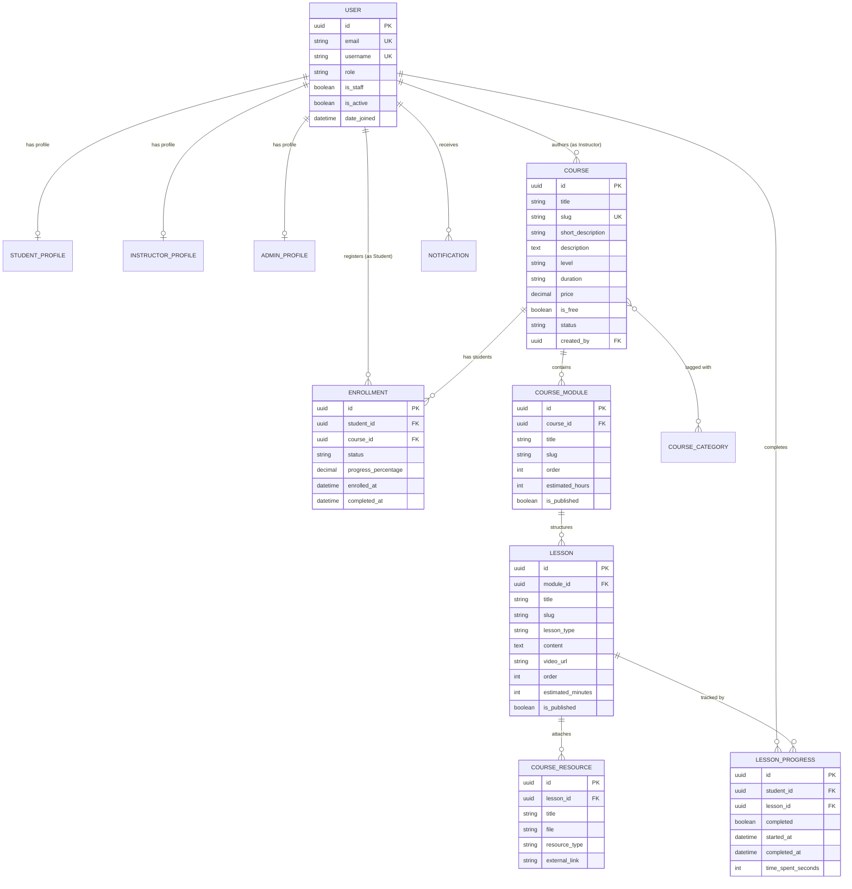

# Future Tech Cyber Security Academy — Database Schema & Data Models

## 1. Entity-Relationship Diagram (ERD)

---

## 2. Table Specifications

### 2.1 User (`accounts_user`)
- **Primary Key**: `id` (UUID4, non-sequential to prevent enumeration).
- **Authentication Field**: `email` (Unique, Case-Insensitive Normalized, Indexed).
- **Identifier**: `username` (Unique, auto-generated from email prefix if omitted).
- **Roles**:
  - `SUPER_ADMIN`: Full system dean access.
  - `ACADEMY_ADMIN`: Academy operations and student management.
  - `INSTRUCTOR`: Course authoring and curriculum publishing.
  - `LAB_INSTRUCTOR`: Hands-on lab facilitator.
  - `TEACHING_ASSISTANT`: Grading and tutoring support.
  - `STUDENT`: Enrolled learner.

### 2.2 Course Hierarchy
- **`Course`**: Root diploma or course track. Contains status (`DRAFT`, `PUBLISHED`, `ARCHIVED`).
- **`CourseModule`**: Sequential curriculum phase.
  - Composite Unique Constraints: `('course', 'order')`, `('course', 'slug')`.
- **`Lesson`**: Granular learning unit.
  - Composite Unique Constraints: `('module', 'order')`, `('module', 'slug')`.
  - Content supports rich Markdown and optional embedded video URLs.
- **`CourseResource`**: Downloadable attachments validated against malicious executables (`.exe`, `.sh`, `.bat`, etc.) with a 25MB threshold.

### 2.3 Enrollment & Progress Tracking
- **`Enrollment`**:
  - Composite Unique Constraint: `('student', 'course')` strictly prevents duplicate enrollments.
  - `progress_percentage`: Decimal(5,2) automatically calculated by `ProgressCalculationService`.
  - `status`: Automatically switches between `ACTIVE` and `COMPLETED` based on percentage.
- **`LessonProgress`**:
  - Composite Unique Constraint: `('student', 'lesson')`.
  - Captures `started_at`, `completed_at`, and boolean `completed`.

