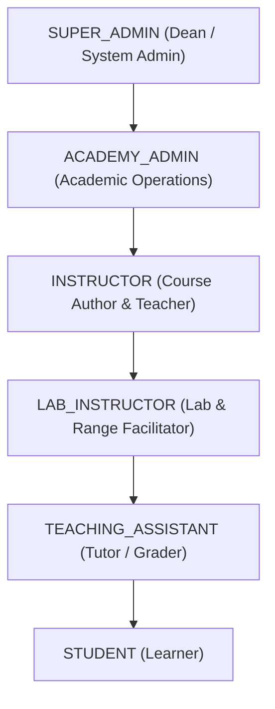

# Future Tech Cyber Security Academy — Security Architecture & Guidelines

## 1. Core Security Mandate
> **IMPORTANT SECURITY DIRECTIVE**:
> All cybersecurity exercises, labs, challenges, and training tools must execute exclusively within authorized, isolated environments. The platform must never be designed or configured to attack arbitrary public Internet targets.

---

## 2. Threat Modeling & Safeguards

| Threat Vector | Platform Safeguard | Implementation Location |
| :--- | :--- | :--- |
| **Malicious File Uploads** | Strict extension whitelist, executable rejection (`.exe`, `.sh`, `.bat`, `.py`, `.elf`), MIME type inspection, 25MB threshold. | `apps/core/validators.py` (`validate_resource_file`) |
| **Privilege Escalation** | Role-Based Access Control (RBAC) enforced across CBV mixins, view decorators, and DRF permission classes. | `apps/core/permissions.py` |
| **Cross-Site Request Forgery (CSRF)** | Synchronizer Token Pattern with CSRF cookies and HTMX headers (`X-CSRFToken`). | `base.html`, `_completion_button.html` |
| **Cross-Site Scripting (XSS)** | Django Template auto-escaping on all user inputs; Markdown sanitized before rendering. | Global Templates & Context Processors |
| **SQL Injection** | Exclusively parameterized query generation via Django ORM; zero raw string concatenation. | Platform-wide |
| **Enumeration & IDOR** | UUIDv4 non-sequential primary keys across users, courses, modules, lessons, and progress records. | `apps/core/models.py` (`BaseModel`) |
| **Clickjacking** | `X-Frame-Options: DENY` header injected into all HTTP responses. | `base.py` & `production.py` |

---

## 3. File Upload Validation Engine

All uploaded lab sheets, cheat sheets, and resource attachments pass through `validate_resource_file()`:

```python
# Allowed Extensions (Non-executable only):
ALLOWED_RESOURCE_EXTENSIONS = [
    'pdf', 'doc', 'docx', 'ppt', 'pptx', 'txt', 'md',
    'zip', 'tar', 'gz', 'png', 'jpg', 'jpeg', 'svg'
]

# Explicitly Disallowed Hazardous Extensions:
DISALLOWED_RESOURCE_EXTENSIONS = [
    'exe', 'sh', 'bat', 'cmd', 'ps1', 'msi', 'bin', 
    'py', 'php', 'js', 'vbs', 'elf', 'dll', 'so'
]

# Maximum upload cap:
MAX_UPLOAD_SIZE_MB = 25
```

---

## 4. Role-Based Access Control (RBAC) Hierarchy



### Access Control Enforcers:
- `RoleRequiredMixin(AccessMixin)`: Base CBV access enforcement.
- `StudentRequiredMixin`: Restricted to students and super admins.
- `InstructorRequiredMixin`: Restricted to instructional staff and admins.
- `AdminRequiredMixin`: Restricted strictly to academic administration.

---

## 5. Phase 2 Docker Sandboxing Directives
For the upcoming Phase 2 container lab runner:
1. **Network Isolation**: Lab containers must communicate only on private Docker bridge networks (`internal: true`).
2. **Read-Only Root Filesystems**: Containers run with read-only root where possible.
3. **Resource Limits**: Hard CPU (`0.5 cores`) and RAM (`512MB`) quotas to prevent denial of service.
4. **Dropped Linux Capabilities**: `cap_drop: [ALL]` with minimal required capabilities restored.
5. **Session Lifetimes**: Automatic termination of lab containers after 60 minutes of inactivity.

